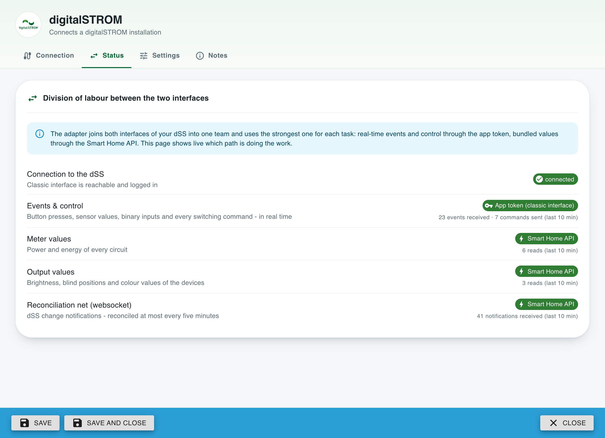
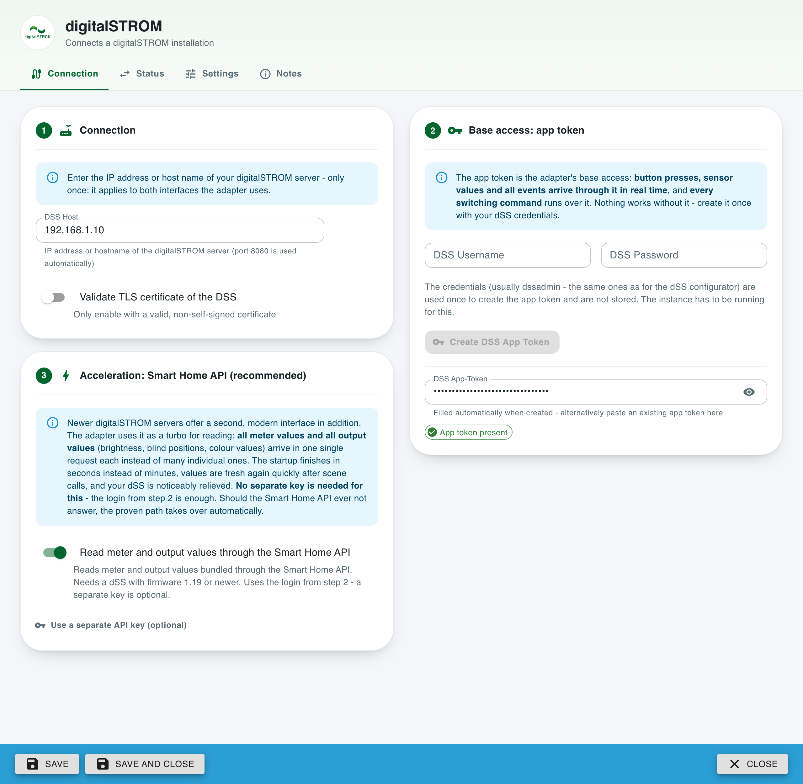
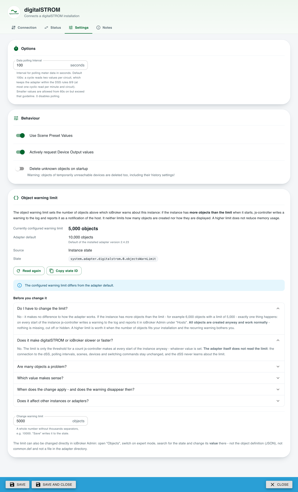
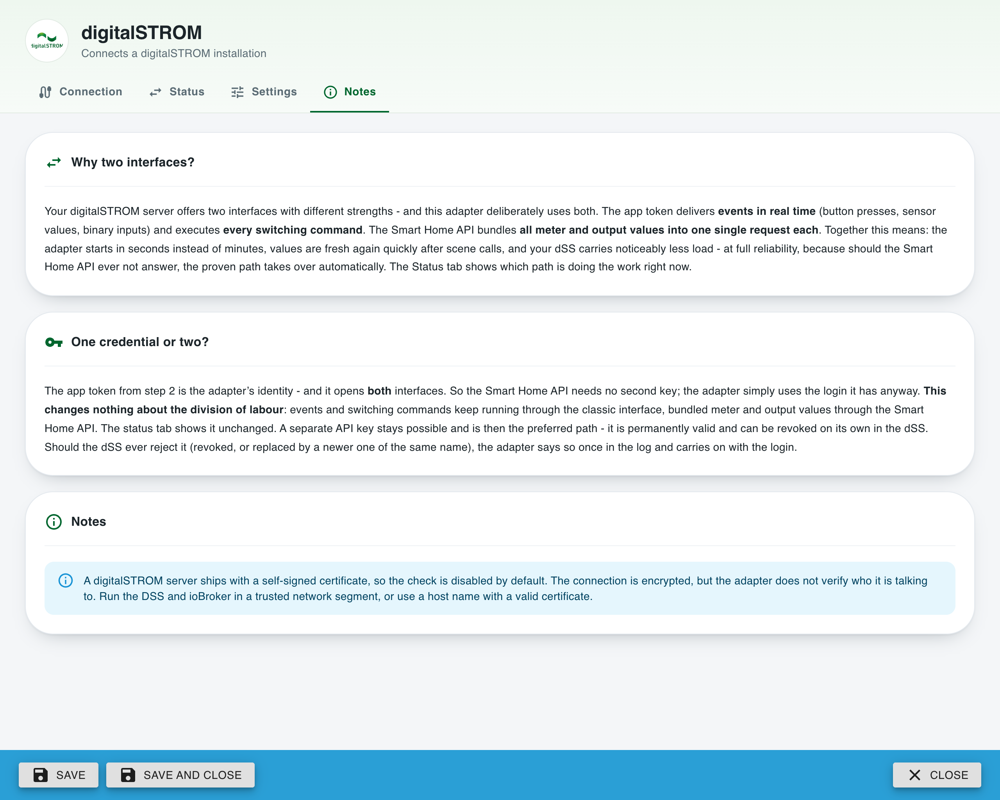
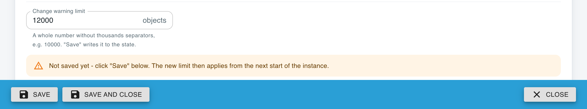
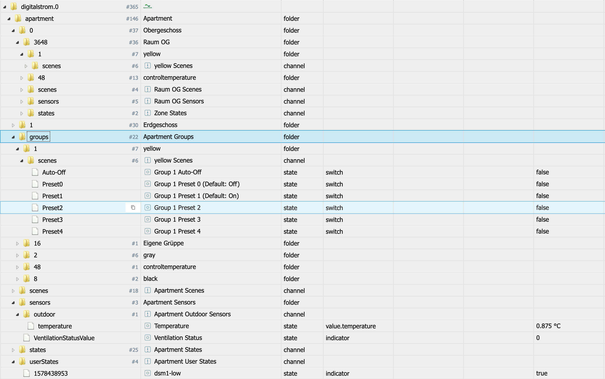
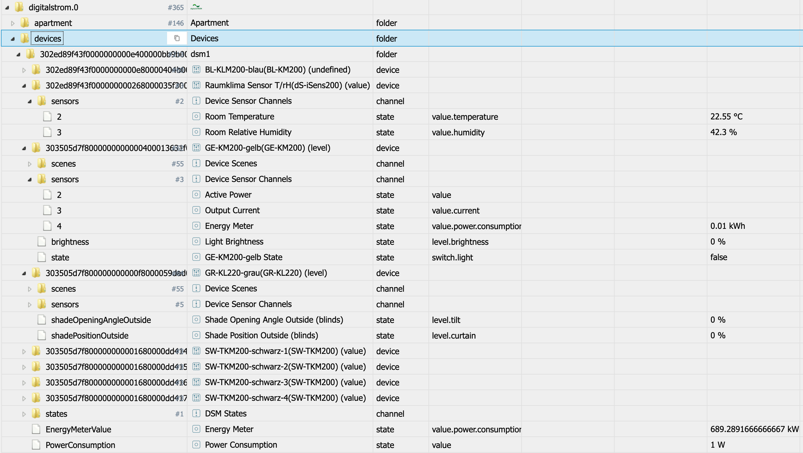

# ioBroker.digitalstrom

**Deutsche Version: [README_de.md](README_de.md)**

## Digitalstrom adapter for ioBroker

Support for digitalSTROM devices via DSS

> This is a maintained fork of [ioBroker/ioBroker.digitalstrom](https://github.com/ioBroker/ioBroker.digitalstrom)
> by Apollon77, which has not been updated since 2021. The original library layer was replaced,
> the admin dialog was rebuilt from scratch, the modern Smart Home API of the dSS is used
> alongside the classic interface and a large number of runtime bugs were fixed.
> See the changelog for details.
>
> This fork does **not** send any error reports: the Sentry plugin of the original adapter was
> removed, because its reports would have been delivered to a project of the ioBroker organisation
> that this fork has no access to.

## Installation

This fork is installed directly from GitHub. The digitalstrom adapter in the normal adapter list of
Admin is the original adapter, not this fork.

In Admin, use the "Custom Install" option with the URL https://github.com/mrandreschmitz/ioBroker.digitalstrom,
or run `iobroker url https://github.com/mrandreschmitz/ioBroker.digitalstrom` on the command line.

Requirements: Node.js 22 or newer, js-controller 6.0.11 or newer and Admin 7.6.17 or newer. The
object warning limit on the settings tab needs js-controller 7.1.0 or newer.

## Two interfaces, one team

A digitalSTROM server offers two interfaces, each with its own strengths - and this adapter
deliberately uses both as a team:

* The **classic interface** (app token) is the adapter's base access: button presses, sensor
  values and binary inputs arrive as **events in real time**, and **every switching command**
  runs through it.
* The **Smart Home API** (`/api/v1`, dSS firmware 1.19 or newer) is the reading turbo:
  **all meter values and all device output values** (brightness, blind positions, colour values)
  arrive bundled in **one single request each** instead of one request per value. On top it
  delivers the room temperature setpoints of every zone, the scene names given in digitalSTROM,
  and a change-notification websocket the adapter uses to reconcile values that were changed
  past ioBroker - for example by a third-party app. A travelling blind carries no value in it,
  but it carries its whole journey, so the position is computed and follows the movement live.

**Both are opened by the same credential**: the app token from the setup. The Smart Home API
needs no second key - a separate API key stays available as an option, and is used first when one
is configured.

Together this means: the adapter **starts in seconds instead of minutes** even on large
installations, values are fresh again quickly after scene calls, and the dSS carries noticeably
less load, comfortably within the digitalSTROM request guidelines. All of it at full reliability:
every Smart Home API task falls back to the classic path automatically, so the adapter stays
completely functional with just the classic interface.

The **status tab** of the instance settings shows this division of labour live - which interface
currently delivers events, meter values and output values, and how much each of them actually did
in the last 10 minutes:

## Configuration

The connection tab walks through the setup: the server address (entered once - it serves both
interfaces), the app token as the base access (created directly from the dialog with your dSS
credentials, which are not stored - the instance has to be running for this), and a switch for the
recommended acceleration. **The app token
opens both interfaces**, so the Smart Home API needs no second credential - a separate API key
stays available as an option behind a link:

The polling interval, the behaviour of the adapter and the object warning limit sit on the settings tab:

The notes tab summarizes the "why two interfaces?" story and the certificate note right inside
the dialog:

Additionally to the connection settings you can edit the following settings to your needs:

* **Read meter and output values through the Smart Home API**: One request serves all circuits,
  one status request all device outputs. Needs a dSS with firmware 1.19 or newer - and nothing
  else: the app token opens this interface as well. Safe to enable: whenever the Smart Home API
  does not answer, the classic path takes over automatically and the adapter keeps running
  unchanged. The switch is off for a new instance - switch it on in step 3 of the connection tab.
* **Data Polling Interval**: How often, in seconds, the power and energy values of your circuits (dSMs) are read. Default 100s, minimum 60s: a value between 0 and 60 is raised to 60s, 0 switches polling of the meter values off completely, and a value that is not a number falls back to the default. Why 100s: the digitalSTROM rules 8 and 9 allow at most one cyclic read per minute and circuit. On the classic interface one cycle reads two values per circuit (`getConsumption` and `getEnergyMeterValue`), and the next cycle only starts once they are answered, so a cycle takes about 20s longer than the configured interval - measured against a real DSS: 60s results in ~1.5 requests per minute and circuit, 100s in exactly 1.0. Lower values stay possible from 60s on, but they exceed the guideline. With the Smart Home API switched on, one single request per cycle reads the values of all circuits.
* **Use Scene Preset Values**: digitalSTROM works mainly with scenes, and for lights and blinds many scenes have a known output value. When this option is on and a scene is called, the adapter writes that preset value to the output states right away; the real values are read shortly afterwards (as long as **Actively request Device Output values** is on). With the Smart Home API switched on, blinds do not use the preset: as long as the output values are requested, their real position follows the movement instead. A preset can differ from the real value, for example when a local priority is set on a device.
* **Actively request Device Output values**: The adapter reads the output values of all devices at start and again after scenes that affect a device. With the Smart Home API switched on this is one bundled status request; without it the values are read individually through the classic interface, and these requests go over the digitalSTROM bus. If that is a problem in your installation, switch the option off - the output states are then no longer read from the DSS. This option only controls **reading** output values from the DSS - writing (e.g. setting a blind position or angle, or a dimmer value) always works, independent of this setting.
* **Delete unknown objects on startup**: When enabled, all ioBroker objects that are not part of the current DSS structure are deleted on adapter startup. Warning: Objects of devices that are just temporarily unreachable (e.g. a powered-off circuit) are deleted too - including their custom settings like history/InfluxDB configurations! Because of that this option is disabled by default; orphaned objects are then only listed in the log.
* **Validate TLS certificate of the DSS**: By default the certificate of the DSS is not validated because the DSS uses a self-signed certificate. Only enable this if your DSS has a valid certificate. See the security note below.

After you have saved the settings with an app token, the adapter restarts automatically. It reads
the structure of your installation (floors, rooms, groups, circuits and devices) and creates the
ioBroker objects for it. Depending on the size of the installation and the performance of your
system this takes a while - several thousand objects are quickly reached, so please give the adapter
time. It already listens to the dSS events while it builds the objects (see the behaviour notes).

As soon as the status light of the instance is green and the log shows "Subscribed to states ...",
everything is ready and you can e.g.:

* call or undo scenes for the apartment, rooms, groups or devices
* read states and sensor values; for rooms you can also push sensor values
* see the values of binary inputs, sensors, buttons and outputs

### Object warning limit

ioBroker (js-controller 7.1.0 or newer) warns when an instance has **more objects than its object warning
limit**. A digitalSTROM installation easily has several thousand objects, so this adapter suggests a limit of
10000. Instances that existed before often still have 5000 - with more objects than that, ioBroker warns at
every start although nothing is wrong.

The card **Object warning limit** on the settings tab shows the limit that is set, the adapter default and the
state. To change it, enter a whole number such as `10000` and press **Save**:

Good to know:

* The limit only controls the warning. It does not create, delete or hide objects, and it makes neither
  digitalSTROM nor ioBroker slower or faster.
* The new limit applies from the **next start** of the instance. Saving the limit alone does not restart it.
* A warning that is already shown is not taken back automatically - acknowledge it in Admin under **Hosts**.
* A good value is a little above the real number of objects, which the warning in the log names
  ("This instance has ... objects").

### Security note about the TLS certificate check

The option **Validate TLS certificate of the DSS** is disabled by default and stays disabled - a digitalSTROM server ships with a self-signed certificate, so enabling validation by default would break every existing installation.

What that means: the connection to the DSS is encrypted, but the adapter does not verify *who* it is talking to. In a local network that you control this is usually acceptable. An attacker who can redirect traffic inside your network (ARP spoofing, a compromised router, an untrusted WLAN) could however place himself between ioBroker and the DSS and would then see the App-Token and every command.

Recommendations, in this order:

1. Keep the DSS and ioBroker in a trusted, separated network segment and do not route the DSS connection over the internet or an untrusted WLAN.
2. If your DSS has a certificate from a public CA (e.g. behind a reverse proxy with a valid certificate), or from your own CA that Node.js on the ioBroker host already trusts (for example through the environment variable `NODE_EXTRA_CA_CERTS`), enter the host name the certificate was issued for and enable the option.
3. Migration path if you want validation with the original self-signed certificate: this needs the certificate itself. The adapter currently supports neither a custom CA file nor a certificate fingerprint - both would be possible technically (`ca` / `checkServerIdentity` of the Node.js TLS agent) and are noted as a possible future enhancement. Until then option 1 or 2 is the way to go.

The App-Token is stored encrypted (`encryptedNative`), is not passed on to other adapters (`protectedNative`), is not written to the log and is shown masked in the admin dialog. The same applies to the optional Smart Home API key.

## State and Object structure

The adapter provides two data structures. The Apartment structure with Floors, Zones (Rooms) and Groups and additionally the structure of Circuits/dSMs and the connected devices with their detail data.

In the structures several "types" of data are included:
* Scenes: Scenes are implemented as switches. Setting the value to "true" will send a "callScene" command for this scene. A value of "false" will send an "undoScene" command for this scene - it is up to the DSS server to decide if "undo" is a valid command! When a callScene or undoScene is triggered as event from the DSS server the relevant scene is set to "true" or "false" with ack=true. Scenes that command a movement instead of selecting a position (Stop, Increment, Decrement, Area Stepping Continue, Impulse) fall back to "false" on their own, see the behaviour notes
* States: the states of the system are shown and are read only. The user defined states of the apartment (`apartment.userStates`) can also be set - the new value is forwarded to the DSS
* Sensor values are updated when triggered by an event. Most sensor values of a zone can also be written: the new value is sent to the server as "pushSensorValue", and it is up to the server whether it accepts the value! This is mainly relevant for Temperature or Humidity values

### Apartment object and states

For the Apartment a structure with "floor"."zone" is created with the following substructures inside this:
* per device group a sub folder is created including the available group scenes
* scenes for this zone
* states for this zone, in rooms the climate control cools passively also the read-only `passiveCooling`
* sensor values for this zone

On Apartment level all device groups are available with it's scenes.

On Apartment level also Sensors (also outdoor values), States and user states are included.

### Devices objects and states

The devices are structured with "circuit/dSM"."deviceID" and the subsctructure inside includes:
* Device Scenes, will be triggered for this device only
* Device Sensors, when reported from the system. So values might be empty
* Output values (e.g. state/brightness for Lights and position/angle for Shades/Blinds) are located directly below the device. digitalSTROM Lights and Shades/Blinds carry the full named functionality; a Joker (Black) with an output - a switched socket, for instance - has its output value read as well, and vDC devices (Hue, Sonos) reach their channels through the named channel read. Device sensors and output channels without a write path are read-only - for instance all channels of a multi-channel vDC light (Hue colour and colour-temperature lamps, brightness included) and the Sonos channels.
* Buttons and Binary Inputs will also be represented by states and are read only

## Behaviour notes

* **Fast consecutive writes**: If a new value is written to the same output while an older value is still waiting in the request queue, the older one is replaced (last write wins) to respect the DSS request rate limits. The replaced request is reported as "superseded" and its value is never acknowledged as written. A write that is already sent to the DSS is never replaced - the newer value is sent afterwards.
* **Host field**: IP addresses, DNS names, full URLs and IPv6 addresses (in brackets) are accepted. Without an explicit port 8080 is used. Credentials, paths or query strings in the host field are rejected.
* **A travelling output**: while a blind moves, the dSS reports no value, but it announces the journey - where it started, where it goes and the window it takes. The position is computed from that during the travel and follows the movement. In the moment the announced end passes nothing is written, so the state never claims the target before the blind is there; the real value follows within about two seconds.
* **User states**: a user state is only forwarded to the dSS when its value really changes, so a script that re-asserts the same value every few minutes causes no requests at all. The value the dSS reports is tracked from both directions, so a state someone changed in the dSS is never mistaken for unchanged.
* **Momentary scenes and button presses**: Stop, Increment, Decrement, Area Stepping Continue and Impulse are commands, not positions - the dSS sends a callScene for them and never the undoScene that would release it again. Their `scenes.<name>` therefore goes true and falls back to false half a second later, so a rule on it fires on every press instead of only on the first one ever. A repeat within that half second re-arms the release rather than adding a second edge, because a wall switch repeats its Stop. `scenes.sceneId` is not released and keeps answering which scene was called last. `<device>.<n>.button` follows the same rule for the same reason: the dSS reports a press and never takes it back, so it goes true and falls back half a second later. `buttonClickType` and `buttonHoldCount` are not released - they describe the press that happened, not the moment.
* **The first two minutes after a start**: the adapter subscribes to the dSS events before it has created its objects, so almost nothing is lost while a large installation is being built. Sensor values, states and binary inputs that arrive in that window are applied once the objects exist, on top of the initial snapshot. Scene calls and button presses in that window are deliberately NOT caught up - acting on a press minutes after it happened would be worse than missing it. The last called scene of every ZONE GROUP is re-read at the end of the start, so a group scene missed there is corrected; a scene the dSS reported for a single device is not, and stays as it was until the next call reaches it.
* **A state the dSS does not know**: the dSS reports some on/off states, for example the room state `heating`, as "unknown" as long as it has no information. Where the adapter shows such a state as true/false, it has no value (null) until the dSS reports active or inactive; a state that keeps the wording of the dSS, such as a user state or a device state, shows the word "unknown". Writing null into a state sends nothing to the dSS.
* **A dSS that cannot be reached**: when the dSS does not answer at startup (for example while it restarts, installs an update or the network is down), the adapter keeps running and asks again every 5 minutes instead of restarting itself. The first failed check is logged as an error that says what to check. Further checks are only logged at debug level, and a different error is reported once more. One info line tells when the dSS answers again and how long it could not be reached, then the start continues. Until then `info.connection` stays false. A dSS that answers but refuses the App-Token is reported as a refused login, with the hint to check the token, and is asked again in the same way.

## Known Issues / System design effects
* The digitalSTROM system is scene-centric by design: most actions are scene calls rather than
  individual value writes, and the adapter mirrors that model. With the Smart Home API enabled,
  the real output values additionally arrive bundled in one status request, so they stay fresh
  without extra bus traffic.
* Values might be empty when they were not reported by the system
* Binary inputs were originally implemented without any hardware to test against. They are confirmed to work in the meantime, with motion detectors and window handles reporting through them. The state keeps the number the DSS reports, so history data stays comparable, but the numbers are named: `inactive`/`active` for a normal binary input, and `closed`/`open`/`tilted` for a window handle, which reports three positions instead of two.
* The full named output functionality - brightness, position and angle - is implemented for
  digitalSTROM Light (Yellow, GE-) and Shade/Blind (Gray, GR-) devices, and a vDC light with a single
  output channel (a dimmable Hue lamp such as the LWV001) takes a brightness value as well. A vDC
  light with several channels (Hue colour and colour-temperature lamps) is read in all its channels,
  brightness included, and is switched and dimmed through its scenes. Of a blind with indoor and
  outdoor channels (GR-KL300) only the outdoor position and angle can be set. A Joker (Black) with an
  output is read as well and follows its scenes, but its value stays the plain, read-only output
  value without a named meaning.
* vDC devices (Hue lamps, Sonos players) read their output channels through the named read
  `device/getOutputChannelValue2` - verified against a dSS20 1.19.13. The audio volume and power
  state of Sonos players and the colour values of vDC lights arrive with and without the Smart Home
  API, and a dSS that rejects the call for a device is remembered per device. Beyond their output
  channels there is no vDC-specific handling, so logs and reports about other vDC hardware are still
  welcome.
* Room temperature control is implemented for the rooms the DSS really regulates: the controller mode and the controller state are read, the operation mode follows the scenes of group 48 and can be set, and the set point of every operation mode is read and writable. Rooms without an active controller deliberately get no such objects.
* Ventilation is covered by the group scenes, the apartment ventilation status and the two boolean output channels (swing mode, auto intensity). Ventilation devices have no dedicated functionality beyond that, because no such hardware was available to test against. Logs and reports are welcome.
* If the configuration dialog shows up only as a narrow strip of about 150 px under the title, update
  Admin: Admin 8.0.11 displayed adapter dialogs like this one that way, Admin 8.0.15 shows them
  normally again.

## How to report issues and feature requests

Please use GitHub issues for this.

Please use the [issues of this fork](https://github.com/mrandreschmitz/ioBroker.digitalstrom/issues).

Best is to set the adapter to Debug log mode (Instances -> Expert mode -> Column Log level). Then please get the logfile from disk (subdirectory "log" in ioBroker installation directory and not from Admin because Admin cuts the lines). Please add a reference to the relevant GitHub issue AND also describe what should be seen in the log at which time.

## Credits and license

This adapter was originally written by **Apollon77 &lt;iobroker@fischer-ka.de&gt;** and published under the
MIT license at [ioBroker/ioBroker.digitalstrom](https://github.com/ioBroker/ioBroker.digitalstrom).
All credit for the original work belongs to him.

This repository is a fork that continues maintenance from version 2.4.0 on (André Schmitz, 2026).
It is published under the same MIT license; the original copyright notice is kept unchanged in
[LICENSE](LICENSE).

## Changelog

### 2.4.27 (2026-10-09)

* **Names the dSS still stores with HTML codes are shown with the real characters.** 2.4.26 corrected such a name
  only when the dSS reported it without the codes today. A dSS keeps a name the way old firmware stored it until it
  is set again, so `getCircuits` can still answer `Büro &amp; Duschbad` - on a real installation three circuit
  folders kept that name after the update, and no correction was logged. Every name from the dSS is now decoded
  before its object is created, so the one-time correction of 2.4.26 takes effect at the first start and the log
  says so. A name you changed yourself is not touched, and no ID changes
* **`INVALID scenecall` is gone.** A scene call that finds no scene state is logged with zone, group and scene. Two
  kinds are expected and go to debug: the climate control calls the scenes of group 48 in every room at its switch
  times, also in rooms without heating, and a command such as Stop on group level only exists as a device scene
  state. Any other one is named once per run at info, then at debug
* **Energy meter values are rounded to whole watt hours.** `EnergyMeterValue` carried values such as
  `4009.7331175000004` kWh, now it is `4009.733`. The total is rounded, not the step, so nothing adds up
* **Unchanged meter readings are not written again.** `PowerConsumption` and `EnergyMeterValue` are polled every 100 s
  and were written every time, although two thirds of the power readings and a third of the meter readings repeated
  the value before. They are now written when the value changes, so the timestamp of these states only moves with a
  change; `info.apiActivity` shows that the meters are still read
* **A value another adapter or a script writes into a polled state is corrected again.** The adapter remembers what
  is in each state so that a poll can skip an unchanged value but still correct a foreign one. The acknowledged echo
  of a foreign write was stored under the ID with the namespace, the polls compared the ID without it, so such a
  value was never noticed. This affected the reconciliation of the device outputs as well
* **The debug log is about half as long.** A command (`ack = false`) is still logged at debug; the confirmations, mostly
  the adapter's own writes and `info.apiActivity` every 30 s, are logged at silly
* **An unknown addon state is named once at info.** States of dSS addons that have no object, such as
  `operationmode.3.NotUsed` of the climate control, were only visible in a debug log. They are now reported once per
  run like any other unknown state. The internal helper states `<dsuid>_open-tilded` and `queue-active` stay at debug

### 2.4.26 (2026-09-26)

* **Rooms no longer report heating as active while the dSS does not know.** As long as it has no information,
  the dSS answers the room state `heating` with "unknown". The adapter counted this word as true, so every room
  showed heating active, and every start logged one warning per room. Such a state now stays empty (null) until the
  dSS reports active or inactive, and the warnings are gone. This applies to every state the adapter shows as
  true/false. States that keep the wording of the dSS, such as the device states (`states.0`, ...) and the user
  states, show the word "unknown" as before. A null that a script writes into a state is no longer sent to the dSS
  as "inactive"
* **States the adapter cannot write are marked read-only.** This covers the colour and brightness channels of
  multi-channel vDC lights (Hue), the volume and power state of Sonos players, the indoor channels of GR-KL300
  blinds, the output value of a joker, all device sensors, the outdoor sensors and `buttonClickType`. These states
  carried no write flag at all, so the admin offered to edit them although a change had no effect. The states that
  can be written (scenes, lights, blinds, single-channel outputs, room sensors, user states, the set points under
  `temperatureControl.setpoints`) are unchanged. A device sensor such as "Room Temperature Set Point" only reports
  the value of the device and is read-only as well; a vis widget or script that still writes it now causes the
  js-controller warning `Read-only state ... has been written without ack-flag`. The room temperature is set
  through `temperatureControl.setpoints.*` or `OperationMode`. The flag is corrected automatically on the first
  start
* **Names stored with HTML codes are corrected once.** Older dSS firmware kept the names of circuits, rooms and
  devices with HTML codes, for example `Schlafen &amp; Bad` instead of `Schlafen & Bad`, and the objects created
  back then kept that name, because the adapter leaves object names alone so that your own renames survive. Such
  a name is now replaced once by the name the dSS reports today, and the log says so. A name you changed yourself
  is not touched
* **The startup report no longer asks for an issue about the second input of a 2-way button.** When the push
  buttons of a shade terminal block such as the GR-KL300 are wired as a 2-way switch, the dSS couples the second
  input to the first and lists the pair as one device, while it keeps a state for the second input. The adapter
  found no device for that state and asked for a GitHub issue. It now names such a state on debug together with
  the device it belongs to, and the info line only lists states that really cannot be assigned
* **A restart the adapter asks for is no longer logged as a warning.** Instead of
  `Terminated (-100): Without reason`, ioBroker now logs `Terminated (START_IMMEDIATELY_AFTER_STOP): restarting
  because ...` with the reason at info level. The instance shuts down cleanly before it restarts. In compact
  mode that keeps the old instance from running on next to the new one, and the restart follows after 1 s
  instead of 30 s. In compact mode the adapter writes the reason in an info line of its own, and the line of
  ioBroker says `Without reason`: js-controller would log a reason handed over there as a warning of the host
* **An unreachable dSS no longer fills the log.** While the dSS could not be reached at startup, the adapter ended
  its process every 5 minutes and started again: one night on a real installation produced 102 restarts, 204 error
  lines and 101 warnings. It now keeps running and asks again every 5 minutes. There is one error that says what to
  check, and one info line with the duration when the dSS answers again. A different error in between, for example
  a refused login, is reported once more. A dSS that refuses the App-Token is reported as a refused login, not as
  unreachable
* **A state of the dSS the adapter does not know yet is named once.** `Unhandled State Change` for a state without
  an object was logged at info level every time it changed: a room crossing its passive cooling threshold wrote
  the same line four times in five hours. It is now logged once per run at info level, and every further change
  of it at debug level. The line says that a state added in the dSS after the adapter started gets its object at
  the next start, and asks to report the name only if it is still reported after a restart
* **Rooms under passive cooling have a read-only state for it.** The climate control of the dSS keeps a state for
  each room it cools passively: active while the room temperature is above the passive cooling threshold set for
  that room, inactive once it drops below. The dSS keeps such states of its apps apart from the other states, so
  the adapter never read it and only logged each change as `Unhandled State Change`. It is now read at startup
  and becomes `apartment.<floor>.<room>.states.passiveCooling` (true/false), with a value right after the start
  and every change the dSS reports. A dSS that does not offer these states starts as before. When reading them
  fails at a start, the states of the last start stay, with their last value, until the dSS reports a change

### 2.4.25 (2026-09-17)

* **An outdoor sensor no longer disappears when the dSS reports no value for it.** The dSS leaves a value out of
  its answer once it has gone stale - an outdoor brightness sensor stops sending in the dark - and the state was
  then not created at all. A sensor that ioBroker already knows keeps its object and its last value now
* **The apartment state `heating_water_system` keeps the wording of the dSS.** A real installation answers
  "hot water", and as a boolean every word but "inactive" collapsed to true, so the operating mode was lost. An
  apartment state without an active/inactive pair is no longer written to the dSS either

### 2.4.24 (2026-09-17)

* **Commands that follow each other quickly keep their order.** A waiting command was merged into an identical
  older one even when another command had been queued in between: on, off, on ended off, and a brightness value
  set while the light was being switched off could be lost. The merged command now moves to the end of the
  queue, so the last wish wins while identical commands still go to the dSS only once
* **A value that keeps changing no longer postpones everything.** Every new value restarted the 500 ms wait, so
  nothing was sent at all while a slider was moving - and a command for another device of the same circuit
  waited just as long. The wait is bounded now: the queue keeps sending while the changes continue, with the
  same minimum distance between two requests
* **The notification channel comes back after a failed login.** When the session login failed while the Smart
  Home websocket was reconnecting, no further attempt followed until the adapter was restarted. The login is
  part of the retry now, and a stop during the login no longer opens a connection afterwards

### 2.4.23 (2026-09-17)

* **The object warning limit can be seen and changed on the settings tab.** Instances that were created before
  this adapter suggested 10000 often still have 5000, and ioBroker then warns at every start. The card shows
  the limit that is really set, the adapter default and the state, explains what the limit does and what it
  does not do, and saves a new value with the normal Save button - without restarting the instance. The new
  limit applies from the next start
* **Closing the dialog with unsaved changes asks only once.** Before, the dialog and Admin both asked
  "discard?" one after the other

### 2.4.22 (2026-09-01)

* **The adapter listens while it is still building.** For 149.7 seconds after the start
  nothing reached ioBroker - every button press, every window contact and every sensor
  reading between "starting" and the active subscription was gone for good. Almost none of
  that was waiting for the dSS: the classic structure read was answered 2.6 seconds after
  the start, the remaining 147 s are parsing it and creating 5231 objects. The subscription
  moves to the front now, and the level values that arrive while the objects are built are
  applied afterwards - on top of the initial snapshot and never before it, because the
  snapshot is the older picture. Button presses and scene calls are deliberately NOT caught
  up: acting on a press two minutes late is worse than losing it, and the scenes are
  re-read at the end of the start anyway. The five zone reads of the build-up also stopped
  sitting on a 10 s grid, which alone was 50.6 s of waiting on an empty queue
* **A poll no longer re-asserts a value that has not moved.** 7661 of 11015 state writes in
  a three hour log carried the value that was already there - 69.6 %, and 197 of the 316
  state ids held exactly ONE value for the whole run. The five minute reconcile rewrote
  ~151 output values every time and changed one of them in three hours; the zone
  temperature states were rewritten after every sync, 875 of 885 identical. Only the
  polling and reconciling paths compare now: an event keeps being published even when the
  number repeats, because "the dSS reported this now" is a message of its own, and so does
  the confirmation of a command, which has to reach its acknowledgement. What is in a state
  is tracked from both directions, so a value another adapter wrote is still corrected
* **A Stop lets go again.** `scenes.Stop` went true on the first press and stayed true: the
  dSS sends the callScene and never the undoScene that would release it - six of them in
  three hours, not one counterpart - so a rule on it fired once and never again. Stop,
  Increment, Decrement, Area Stepping Continue and Impulse are released after half a
  second, and a repeat re-arms that instead of adding a second edge, because a wall switch
  repeats its Stop (measured three times within 481 ms while the blind never moved). A
  blind driven to Maximum keeps its latch - it really IS at Maximum - and the scenes of the
  temperature control group, where the same numbers mean lasting modes, are untouched.
  `scenes.sceneId` still answers which scene was called last
* **A pressed button lets go again.** `<device>.<n>.button` had exactly the problem the
  momentary scenes had, on the state right next to them: the dSS reports a press and never
  takes it back, so the state stayed true from the first press to the end of the run and a
  rule on it fired once. It is released after half a second now, from both paths that set
  it - the button event and the scene call a wall switch produces. `buttonClickType` and
  `buttonHoldCount` keep their values; they describe the press, not the moment
* **Five apartment states finally carry a value.** `daylight`, `daynight`,
  `daynight_indoors`, `twilight` and `holiday` were created empty and stayed empty, because
  the adapter read only the word a state describes itself with. The dSS sends these five
  with a raw value and no word at all - measured: `{"name":"daylight","value":true,
  "script_id":"solar_computer"}` - so there was nothing to read. Both forms are taken now,
  and the conversion handles a boolean as well as "off"
* **A vDC read counts as a read, and may be repeated.** The status tab showed the chip
  "classic" next to 0 output reads while 136 of them were running for four Sonos players:
  the named channel read is called `getOutputChannelValue2` and matched no counter. The
  same read was also missing from the retryable requests, although for a Sonos player it is
  the ONLY path to volume and power state
* **Six devices stop being called "(undefined)".** `outputMode 64` is a heating valve
  terminal and was not in the map. An unknown mode no longer reaches the object name at
  all; it is logged instead. Existing installations keep the name they have
* **Four apartment states say what the dSS really sends.** They declared "true"/"false"
  while the dSS answers "active"/"inactive". The values were right anyway through the
  fallback, but a write would have sent the wrong word - and the only line that said so sat
  on debug and fired five times unseen. It warns once per state now
* **The startup report stops asking for issues about our own decisions.** Of the 45 states
  it listed as unassignable, 42 belonged to zones and groups this adapter had itself
  decided not to build objects for. They are subtracted now, so what is left are the names
  that really belong to nobody
* **The cluster locks get the words the dSS answers with.** `user_lock` and
  `operation_lock` were created without a value mapping, so their write handler could only
  ever warn - the path behind it had never run
* **The hourly probe of a learned channel stops costing four answers.** A channel the
  status never answers is probed once an hour so the learning cannot latch forever, and
  that probe spent the full follow-up budget: twelve of the eighty-four status requests of
  a three hour run, healing nothing. It rides along with one status request now
* **Three numbers meant something else than they looked like.** `info.apiActivity`
  announced a ten minute window and measured between nine and ten, 4.9 % low and always in
  the same direction. The shutdown printed a long-poll deadline where it read like a
  duration, suggesting 15 s for an unload that took 116 ms. And "Plan next queue entry"
  named the entry that had just finished while the priority in the same line belonged to
  the one being planned

* **A blind no longer gets the guessed scene value written first.** The preset was the stand-in
  for a position nobody could know while the blind travelled - with the Smart Home API the real
  one arrives about two seconds later and follows the movement, so the guess only added a jump.
  It also carries the value of the GROUP scene, which is not always where the individual device
  travels: measured on a real installation, a blind was written 50 while it went to 60, and that
  wrong value stood for 21 seconds. Without the Smart Home API the preset stays exactly as it was
* **A user state is only written to the dSS when its value really changes.** Scripts that
  re-assert their states every few minutes had every single write forwarded, even when the dSS
  already held that value - measured: 31 pointless requests in 40 minutes, by then the largest
  remaining load on the classic interface. The value the dSS reports is tracked from both
  directions, so a state someone changed in the dSS is never mistaken for unchanged
* **A travelling output no longer reports its target before it arrives.** The interpolation used
  to clamp at the target, so once the announced end had passed while the dSS still said "moving",
  the state claimed the blind was there - seen on a real travel 2.1 seconds early. Nothing is
  written in that moment now; the real value follows within about two seconds, because the channel
  keeps its fast schedule for a short grace period after the announced end (a device stuck on
  "moving" still runs into the normal follow-up handling)

* **A joker with an output follows its scenes.** A switched socket has an output value, but no
  read path of its own: it only ever arrived with the next reconciliation - measured on a real
  installation, the value of a socket switched on at 10:20:04 appeared at 10:21:02, 57 seconds
  later. It is now read at startup and right after a scene call, through the same bundled status
  request every other device type uses, so a whole room still costs ONE read. Without the Smart
  Home API nothing changes: a joker output has no other way to be read, and the reconciliation
  stays responsible

### 2.4.21 (2026-08-31)

* **vDC devices (Hue, Sonos and friends) read their outputs at all for the first time.** They have
  no typed device path of their own, so the generic branch left them without any read: one channel
  got an offset read the dSS cannot answer for them ("Could not find item. deviceOutputIndex:255"),
  several channels got nothing but a debug line. Their values existed only where the Smart Home API
  status happened to carry them. Now the named read `device/getOutputChannelValue2` serves them -
  verified live against a dSS20 1.19.13: the audio volume and power state of Sonos players get
  values for the first time ever, and the colour values of vDC lights work without the Smart Home
  API too. One answer carries every channel of a device and concurrent requests coalesce into one.
  A scene call refreshes the values right away as well: through the bundled status request, or -
  without the Smart Home API - through one named read for the device the scene addressed directly.
  Native terminals keep their offset read (filtered by the structure flag), and a dSS that rejects
  the named call is remembered per device
* **Metering sensors the dSS marks invalid are read once at startup** (low priority, one bus read
  per sensor): active power, output current and apparent power of measuring terminals. A device
  with constant consumption - a printer in standby - may not send a sensor event for months, so
  these states stayed empty since their objects were created. Energy meter and high range current
  natives have unverified resolutions and deliberately stay with the events
* **The Smart Home API key is optional now.** The new API also accepts the login of the classic
  interface as a cookie - measured against a dSS20 1.19.13 for every endpoint this adapter reads
  AND for the notification websocket. Without a key the adapter simply uses the login it has
  anyway, so the Smart Home path needs no second credential. And a key the dSS rejects (revoked,
  or replaced by a newer one of the same name) no longer takes the path down: the adapter says so
  once, switches to the login and keeps going. A configured key stays the primary path - it is
  permanent and needs no renewal
* **A blind now follows its travel live instead of jumping at the end.** The status leaves the
  value out while an output moves - but it carries the whole journey: where the travel started,
  where it goes, and the window it takes. Every movement brings its own window from the dSS, so
  a slow awning and a fast roller shutter are equally right and nothing is assumed. The position
  is computed from it and written during the travel, the channel stays open for the real final
  value, the next read is due right after the travel ends instead of on the fixed 15 s grid, and
  a running travel no longer burns the follow-up budget (measured live on a dSS20 1.19.13: a full
  travel from 100 to 0 in 24.8 s)
* **The CIE x/y colour coordinates arrive correctly scaled.** The channel scale delivers them as
  0..1 while the states hold 0..10000 - since 2.4.18 rounding collapsed every coordinate to 0
  or 1 on the Smart Home API path; the new named read applies the same corrected factor

### 2.4.20 (2026-08-31)

* **The power level alias scales correctly.** The live smoke test of 2.4.19 refuted the assumed
  0..100 scale of the `level` field: a switched socket powering a device reported `level: 1` and the
  `powerLevel` state showed "1 %". The field is 0..1 (matching the structure, which normalizes the
  switch threshold to 0..1 as well) and is now scaled and clamped to the 0..100 state

### 2.4.19 (2026-08-31)

* **`info.outputApi` no longer ping-pongs between the two APIs.** On hybrid installations single
  channels the status structurally never delivers (measured live: the outputs of audio devices are
  missing from the status entirely) made the state flip to "classic" about a minute after every
  reconciliation and back with the next one - roughly every five minutes, around the clock. Classic
  reads the sync hands over for such single channels no longer report; "classic" now shows while
  the status request itself fails, while the Smart Home path pauses in its backoff, with the option
  off - or once at adapter start when a generic single-channel device (neither light, shade nor
  joker hardware) delivers its initial value via the deliberately classic read
* **Channels the status never answers are learned** after two exhausted follow-up budgets and go to
  the classic read immediately - their values arrive ~60 s earlier and the pointless follow-up
  status requests (four per trigger, ~59 KB each) stop. A later status answer that carries such a
  channel again heals the learning automatically
* **Two id mismatches of the status are resolved by aliases**, so the affected channels are served
  by the Smart Home API after all: a switched socket (SW-KL200) reports its declared `powerLevel`
  as the `level` field of a `powerState` output, and blinds (GR-KL300) report the single class-64
  shade bank only under the `...Outside` ids although they declare the `...Indoor` channels as
  well - the classic read would have delivered the identical value to both. The `powerLevel` state
  of such sockets gets a value for the first time ever
* The helper states of the dSS window-states addon (`<dsuid>_open-tilded`) log at debug instead of
  info level - the window state itself arrives via the binary input and the device state anyway
* **The status tab shows live what each interface actually did** in the last 10 minutes
  (`info.apiActivity`, published every 30 s): received events and sent commands of the classic API,
  meter and status reads of the Smart Home API and its notifications - the proof that a path really
  works, not just that it is configured

### 2.4.18 (2026-08-31)

* **Device output values can be read through the Smart Home API.** With the option enabled, the
  initial reads at startup and the re-reads after every scene call are served by ONE apartment
  status request (~59 KB, ~100 ms for every device at once) instead of one throttled classic read
  per output channel - the part of the startup that could take minutes on large installations.
  The status delivers each output already in the scale of the ioBroker states, verified offline
  against a real object export: every comparable value matches, and 132 channel states the classic
  path never managed to fill (hue, colortemp, x, y of the lights) finally get their values
* The rules learned from live measurements are built in: an output that is currently **moving
  carries no value** in the status and keeps its last state (asked again after 15 s, at most four
  times, then the classic read has the last word); an answer that was already on its way never
  satisfies a trigger that arrived after it left; boolean channels stay on the classic read; a
  failed status request falls back to the classic reads at once and pauses the Smart Home path for
  five minutes. With the option off, the values behave exactly as before - the only difference is
  that requests which never worked are no longer sent (a light's colortemp read always went out
  broken and only ever produced a warning)
* **The new-API client cannot hang any more.** A connection dying in the middle of a response body
  used to leave the request pending forever - no error, no retry. The classic client always had
  this handler, the new one was missing it. A wrong password during key creation now surfaces the
  actual answer of the dSS instead of a generic sentence
* **The API key dialog uses the app token from the form.** Creating the app token and the API key
  in one visit used to fail with "Please create or enter the App-Token first", because the instance
  only knew the SAVED token. A stored API key that does not look like one (typically: js-controller
  could not decrypt it after a backup restore) is called out at startup instead of an anonymous
  HTTP 401, and a dSS without /api/v1 (HTTP 404) backs off to the maximum right away and says so
  once instead of warning every hour
* Groundwork hardening of the notification websocket (still unused): dead connections are detected
  by pinging after 30 s of silence and reconnecting after 90 s, fragmented messages are capped in
  total size, and the debounce defaults follow the measured reality (5 s coalescing, 15 s maximum)
* **The notification websocket is now used - as a deliberately throttled safety net.** Every meter
  tick fires a payload-free notification (measured: 17 in 75 seconds), while buttons and scenes are
  already reported precisely by the classic events. A notification therefore triggers a
  reconciliation of all output values at most every five minutes: it catches what happens past
  ioBroker - a third-party app writing an output directly - without adding steady load. The channel
  reconnects on its own, and a dSS without it changes nothing
* **Each status answer also refreshes the room temperature control of every zone** - setpoint and
  control value, verified degree- and percent-identical against a real installation; the operation
  modes stay with the classic path. And the scene names given in digitalSTROM are loaded once from
  the new API to fill the gaps the classic naming leaves
* **The settings explain the hybrid approach and show it working.** The connection tab walks
  through three numbered steps - server address (entered once, it serves both interfaces), the app
  token as the base access in its natural order (credentials first, the created token lands below),
  and the Smart Home API key as the accelerator - side by side on a PC screen. A new status tab
  shows the division of labour live: which interface currently delivers events, meter values and
  output values, backed by the new state `info.outputApi`, the counterpart of `info.meteringApi`

### 2.4.15 (2026-08-30)

* **The dialog scrolls by itself now.** It used `minHeight: 100%` and relied on the surrounding frame
  to provide the scrolling. Where that frame does not scroll, everything below the first screen height
  was unreachable and the lowest button stayed under the save bar - which is why more bottom spacing in
  2.4.12 and 2.4.14 did not help. With `height: 100vh` and its own `overflow-y` the content is reachable
  in either case; verified against a deliberately non scrolling frame, 71 px clear below the last button

### 2.4.14 (2026-08-30)

* **The meter values can optionally be read through the new Smart Home API.** One request for all
  circuits instead of two per circuit - measured on a dSS 1.19.13 with six circuits: 12 requests in
  734 ms become one in 114 ms, which takes the steady load of this adapter from about 8.7 to about
  2.1 requests per minute
* The switch is **off by default** and every failure falls back to the classic API, so nothing changes
  until it is turned on. The API key is created from the EXISTING app token, no password is needed
  again
* Values and states stay identical. Both APIs were compared against each other beforehand: five of six
  circuits matched to the watt second, the sixth differed by exactly the time between the two reads.
  The unit is watt seconds, so the conversion `value / 3600 / 1000` is unchanged - note that the API
  declares `Wh`, which is demonstrably wrong and would have been off by a factor of 3600

### 2.4.13 (2026-08-30)

* **One long-poll instead of nine.** `subscribeEvents()` gave every event name its own
  subscription id, so nine `event/get` long-polls were open at the same time, each of them
  re-established every 40 seconds. The DSS allows many event names on ONE subscription id -
  that is what openHAB and the Home Assistant integrations do - and answers all of them
  through a single `event/get`. All events now share the id from the configuration (42 by
  default), which removes the biggest steady load the adapter put on the DSS. Nothing about
  the events themselves changes
* Two details follow from that: a re-subscribe after a failed poll registers **every** name of
  the channel again, because the DSS loses the whole subscription id and not just the one name
  whose poll failed; and the polling only starts after the last subscription, so no event can
  be missed while a subscription is still on its way. Unsubscribing at the end is one request
  instead of nine
* The lowest button of a tab needed more room below the save bar of the admin than 2.4.12 gave
  it. The design preview (`npm run dev:admin`, `preview.html`) now shows a stand-in of that bar
  so the spacing can be checked without the admin
* New: `scripts/probe-smarthome-api.js` reads a DSS through the new Smart Home API
  (`/api/v1` plus the notification websocket) and writes every answer to a directory. It is the
  groundwork for the decision whether the adapter can be moved to that API

### 2.4.12 (2026-08-30)

* **The app token was decrypted twice.** It was named in the `encryptedFields` option of
  `GenericApp` and, at the same time, in `encryptedNative` of io-package.json - and
  `onPrepareLoad` decrypts its own list plus the fields of `encryptedNative`. Decrypting twice
  returns the ciphertext, so the dialog would have shown an unusable value and saving from
  there would have stored a token the adapter cannot use. `encryptedNative` alone is
  authoritative now, and a test makes sure the field is not declared in both places again
* The lowest button of a tab sat directly underneath the save bar of the admin, which is fixed
  to the bottom edge. The content keeps room below it now

### 2.4.11 (2026-08-30)

* **Fixed a configuration dialog that could not connect.** The React dialog introduced in
  2.4.10 only reported `Socket connection could not be initialized: Error: Socket library could
  not be loaded!` and stayed empty. `@iobroker/socket-client` does not bring socket.io along,
  it expects the page to have loaded it as a global - admin serves it at
  `/lib/js/socket.io.js`. The page loads it now and offers `registerSocketOnLoad`, so the
  client is told when the library is there instead of polling for it. A test checks both,
  because the dialog is unusable without them and nothing else notices

### 2.4.10 (2026-08-30)

* **The configuration dialog is a React application of its own now.** jsonConfig describes a
  form, it does not design one - headers were rendered as full width bars in the primary colour
  of the admin theme, and the colours set for them only ever reached the text. The dialog is
  written directly instead: a light surface independent of the admin theme, raised cards per
  topic, a header with the adapter icon and tabs with icons. The app token can be revealed and
  says whether it is stored. Sources live in `src-admin`, the build lands in `admin` and is
  committed, because the adapter is installed straight from this repository. All eleven
  languages were taken over from the former `admin/jsonConfig.json`, nothing was translated
  anew. `npm run build:admin` builds it, `npm run dev:admin` serves `preview.html` for looking
  at the layout, and the workflow rebuilds the bundle and fails if it differs from the
  committed one
* This also removes a whole class of error: the credentials for creating an app token used to
  travel through a JavaScript template literal in `jsonData`, where a quote in a password could
  break the message. They are now passed as a plain object. The 43 tests that guarded the
  jsonConfig and that escaping were dropped, 6 new ones check the built interface, the
  agreement of the eleven translation files and that every text the dialog asks for exists
* **Binary inputs name their values.** The state kept the bare number of the DSS, so a window
  handle read 1, 2 or 3 without anything saying what that meant. Observed on an EnOcean window
  handle (F6-10-00), each position checked against the readable device state of the same
  handle: closed 1, open 2, tilted 3. Every other binary input keeps two values, 1 inactive and
  2 active. The type stays `number`, so existing history data remains comparable
* Dependency updates: `@apollon/iobroker-tools` 0.3.0, `actions/checkout` 7,
  `actions/setup-node` 7, `@types/node` 26, `@types/sinon` 22, `@types/proxyquire` 1.3.31,
  `@alcalzone/release-script-plugin-license` 5.2.2. chai 6, sinon-chai 4, chai-as-promised 8
  and TypeScript 7 were deliberately not taken: the chai family is ESM only, which the type
  check of a CommonJS project rejects, and `@typescript-eslint` pins TypeScript below 6.1

### 2.4.9 (2026-08-30)

* **Fixed an invalid admin configuration.** The two dividers of the layout introduced in 2.4.5
  carried a colour of the digitalSTROM palette, but the schema only allows `primary` and
  `secondary` for that property. admin therefore rejected the whole config with
  `digitalstrom has an invalid jsonConfig` and fell back to a generic dialog. The colour now
  lives in `style`/`darkStyle`, where a free colour is allowed. Two new tests check the enum
  constrained properties of the schema, so this class of error cannot come back unnoticed
* The release workflow of this fork no longer tries to publish to npm - the package name
  belongs to the upstream project. A pushed tag `v<version>` now only creates the GitHub
  release, and its text comes from the message of the annotated tag

### 2.4.8 (2026-08-30)

* Removed the App-Token migration note from the admin dialog and from the readme. No public
  release ever shipped the misplaced `encryptedNative` declaration, so a permanent hint about
  a migration nobody has to do would only confuse. The adapter still detects a token it cannot
  read back and says so in the log, now without referring to a version history

### 2.4.7 (2026-08-30)

* **The default data polling interval is 100s instead of 60s.** Measured against a productive
  installation with 6 metering circuits: a cycle reads two values per circuit
  (`getConsumption` + `getEnergyMeterValue`) and the timer for the next cycle only starts once
  both are answered, so a cycle takes roughly 20s longer than the configured interval. With 60s
  that resulted in a measured 1.53 requests per minute and circuit - one and a half times what
  the digitalSTROM rules 8/9 allow. 100s gives a cycle of about 120s and therefore exactly 1.0.
  The claim in 2.4.4 that 60s complies with those rules counted only one read per cycle and was
  wrong. The minimum stays at 60s: lower values remain possible, they are now just honestly
  documented as exceeding the guideline instead of being called compliant

### 2.4.6 (2026-08-30)

Built from the object export and the debug log of a productive installation.

* **Room temperature control.** Every room the DSS really regulates gets a channel
  `temperatureControl` with `ControlMode` (which kind of controller), `ControlState` (who
  owns the set point) and `OperationMode` - a readable, writable mirror of the group 48
  scenes that follows every scene call. Rooms with `ControlMode: 0` deliberately stay
  without those objects, so it is visible at a glance which rooms are regulated at all
* **Set points per operation mode.** They are read with `zone/getTemperatureControlValues`
  and written with `zone/setTemperatureControlValues`. The field names are taken from the
  answer instead of being hard coded, and the states are only created when the DSS really
  answered - a firmware without that endpoint gets no set point objects rather than dead ones
* `NominalValue` stays writable but only takes effect when the zone is under external
  control (`ControlState` = external). With the internal controller the DSS overwrites the
  pushed value - use `OperationMode` or the set points instead
* **Cluster states.** `cluster.<id>.user_lock` and `cluster.<id>.operation_lock` had no
  object at all, although the group folder of the cluster exists. They are created below
  `apartment.groups.<id>.states` now
* **Group states with a dot in their name.** `status.malfunction` and `status.service` of
  the ventilation groups were dropped by a pattern that only matched a single segment. They
  are created as nested states now, including the channel in between
* The check for rooms that belong to no floor evaluated `isValid` as a plain truthiness
  check. A real DSS does not send that flag for a zone at all, which silenced the check
  completely. It now only skips a zone that the DSS explicitly marks as invalid or as not
  present (`isPresent: false`, e.g. the dS zone 65534 for unassigned devices)

### 2.4.5 (2026-08-30)

* Redesigned the admin configuration. The options are split into the tabs **Connection**,
  **Settings** and **Notes** instead of one long page, with section headers, info boxes and
  switch cards in the digitalSTROM colours (`#00662E` / `#7FC241`, taken from the logo)
* The new **Notes** tab explains the certificate check
* No option was renamed and none was dropped - existing instance settings are taken over
  unchanged. A test now asserts that every option of `native` still has a control

### 2.4.4 (2026-08-14)

Found by a systematic multi-agent review of the whole adapter. All of these defects already
existed in 2.4.2 and earlier - they fail silently, which is why they never showed up as an error.

* **A scene called for a whole room never reached the device handlers.** `zoneDevices` is only
  keyed by the real device groups (1, 2, 8 ...), never by the broadcast group 0, so the fan-out
  found nothing - and the forwarding loop that runs afterwards is marked as "forwarded", which
  disabled it as well. Effect: after every "room off" the states `brightness`,
  `shadePositionOutside` and `shadeOpeningAngle*` kept their old value until the next group
  scene hit the same device or the adapter restarted, without a single log line. The adapter
  triggers this case itself: its own room scene states send `zone/callScene` without a groupID
* **The App-Token is now really stored encrypted.** `encryptedNative` and `protectedNative` were
  declared inside `common` instead of at the root of io-package.json, where `ioBroker.AdapterObject`
  expects them. Neither took effect, so the token was kept in plain text in the object database,
  was readable by every other adapter and was contained in every backup in the clear.
  **Migration:** a token that was saved by an older version cannot be decrypted and is read back
  as garbage. Open the adapter configuration once, enter the App-Token again (or create a new one
  with your DSS login) and save. The adapter now detects this case and says exactly that instead
  of only reporting a failed login
* **Every press of the first button was dropped on some devices.** The state of button 0 was only
  created for `buttonActiveGroup` 1..8, while the click type and hold count states of the same
  button were always created - and the event handler aborts when the plain button state is
  missing. On a keypad whose button is unassigned, on broadcast, or in a group above 8, buttons
  2..n worked while button 1 only produced `INVALID Button click`
* Button click type and hold count were written with the raw DSS string into a state declared as
  a number, so js-controller warned on every press and the `states` mapping did not resolve
* `EXTRANOUS ZONE found <id>` was logged for every regular room at every adapter start: the check
  ran synchronously while the rooms are processed through `setImmediate`, so its bookkeeping was
  still empty
* **"Request device output values actively" = false suppressed the scene preset values as well.**
  The option is documented to control only the reads; the preset values belong to "Use scene
  preset values". The gate sat in front of the device handler instead of in front of the read
* The output channel `shadePositionIndoor` was named "Shade Position **Outside** (curtains)".
  Existing objects keep their old name - ioBroker preserves the name on update

### 2.4.3 (2026-08-12)

**Runtime fixes**
* Event recovery could hang forever: a successful `event/subscribe` reset the error counter, so a DSS that accepted the subscription but answered every `event/get` with HTTP 500 never reached the error limit. The adapter stayed green and re-subscribed every two seconds without ever processing an event again. The counter is now only cleared by a really successful `event/get`, the backoff grows and the defined `eventError` / restart path is reached reliably
* The stop is a real barrier now: asynchronous startup callbacks that finish during or after the unload no longer create timers, requests, state subscriptions or `connected = true`, `DSS.requestAsync()`/`httpRequest()` reject every request after `stop()`, and a still running App-Token dialog is tracked and closed by the unload (no late `sendTo` and no late log lines from that flow)
* **Request Device Output values actively = false** disabled the whole blind control: detection of position/angle, the write handlers and the initial read were in one block, so with the option switched off no write command reached the DSS at all. Writing is now independent of the option, which only controls whether output values are *read* (initially and after scene events, for blinds and lights alike)
* Scene 22 and scene 25 were both called "Preset 24" and therefore shared one state id. The remaining handler controlled scene 25, scene 22 was not reachable. Scene 22 is called "Preset 14" again (as the code comment already said) and a test now checks all generated scene state ids for uniqueness
* Queue coalescing is re-entrant: the queue entry is replaced *before* the superseded callbacks run. A value that is enqueued synchronously from a superseded callback (typical for a moving slider) is no longer overwritten by the older call. Guaranteed: the newest value is sent exactly once, a replaced value is never sent, every callback finishes exactly once, no callback is lost
* A superseded write is no longer reported as a warning. The message `Error while set State for apartment-user: SupersededError: ... was superseded by a newer value` was normal last-write-wins coalescing, not a DSS error. Expected queue cancellations are now classified centrally (`DSSQueue.isExpectedQueueError`) and only logged at debug level for all consumers (apartment, apartment-user, circuit, device output, zone, group). Real network, DSS and response errors still produce a warning
* Events could get lost during startup: the handlers were only registered after *all* subscriptions were done, while every single subscription starts polling as soon as it succeeded. The handlers are now registered before the first poll can emit anything (and never twice). In addition the artificial two second wait before subscribing was removed, and once the subscription is active the last called scenes are checked once with the lowest priority so scene calls during a long startup are applied afterwards

**Further fixes**
* The boolean output channels `airLouverAuto` (ventilation swing mode) and `airFlowAuto` (ventilation auto intensity) accepted only numbers and rejected `true`/`false` - they are switchable again and are sent to the DSS as 0/1. Invalid types are still rejected in a controlled way
* The apartment ventilation status (sensor 60) was created as a boolean, which turned every status code other than 0 into `true`. It is a numeric state again and keeps all DSS status codes (0 = OK, 2 = Malfunction, 4 = Service, 6 = Malfunction+Service)
* Heating and ventilation groups activated the generic scene state (e.g. `Preset0`) on startup while every event toggled the special one (e.g. `HeatingOff`). The initial state is now resolved via the state map, exactly like the event handling does
* Apartment specific cluster names no longer leak between adapter instances: every structure gets its own copy of the group type map and the module constants are never modified at runtime
* Host normalization: an explicitly configured default port was replaced by the DSS default port 8080 when the host ended with a slash (`https://dss.local:443/` became `https://dss.local:8080`, the same for `http://...:80/` and IPv6). Fixed for host names, IPv4, IPv6, with and without trailing slash
* A request timeout produced by the adapter itself now carries a structured marker (`code: 'ETIMEDOUT'`), so the retry classifier recognizes it and a safe read is repeated once. Write requests are still never repeated
* `apartment/getReachableGroups` (a pure startup read) may be repeated once after a connection error

**Configuration and maintenance**
* The minimum data polling interval is 60s now instead of 10s. digitalSTROM rules 8/9 allow at most one cyclic read per minute and circuit, and one cycle already issues several measurement reads per circuit. Configured values between 1 and 59 are raised to 60s, 0 still disables polling completely. **If you configured a value below 60s, the effective interval changes with this update**
* The App-Token is no longer displayed as plain text in the admin dialog (it was already stored encrypted and protected)
* CodeQL updated from the unsupported v2 to v4
* Node.js 22 is the minimum required version (Node 20 is end of life), CI and release run on Node 22 and 24
* The Dependabot auto-merge workflow was hardened: it no longer checks out pull request code, runs only for pull requests really opened by Dependabot, uses the automatically provided `GITHUB_TOKEN` with minimal permissions instead of a personal access token, and pins the official `dependabot/fetch-metadata` action to a full commit SHA. Merging now happens through GitHub auto-merge, so required checks have to pass first. The policy became stricter: production dependencies only for patch updates, development dependencies for patch and minor updates
* The whole project is free of type errors now: `npm run typecheck` (`tsc --noEmit` with `strict` and `checkJs`) runs in CI and must stay green. All types are declared with JSDoc - no suppressions, no weakened compiler options
* DSS states that belong to no device, circuit, room, group or the apartment are reported once with their exact name instead of silently having no object at all
* Dev dependency updates: 0 known vulnerabilities at all. The findings in mocha and @iobroker/testing are fixed through npm `overrides` (serialize-javascript, diff, esbuild) instead of downgrading the test tooling

### 2.4.2 (2026-08-02)
* Do not use HTTP keep-alive anymore. The DSS closes idle connections, which caused sporadic "socket hang up" errors on the next request (2.3.0 did not use keep-alive either)
* Add the missing role to the binary input states (no more "property common.role missing" warnings)
* Map boolean states via the value mapping reported by the DSS and understand the usual off words (off/inactive/no/0) instead of turning every non-empty string into true
* Convert values delivered by the DSS to the type declared for the object. The DSS reports numbers as strings, which produced "has to be type number but received type string" messages for sensor values, scene ids and states
* Retry a **read** request once when the connection was closed without an answer ("socket hang up"). Actions with side effects (`callScene`, `undoScene`, `event/raise`, `state/set`, `pushSensorValue`, output writes) are never repeated automatically - after a connection error the DSS may already have executed them, so a repeat could trigger the scene or an external automation a second time
* Do not write state values before the corresponding objects exist (no more "has no existing object" warnings during startup)
* Log unsupported output channels (e.g. the media channels of dS audio devices) at debug/info level instead of flooding the log with warnings
* Use a separate connection pool for the event long-polls. With 9 parallel long-polls the shared pool (4 sockets) could block every normal command like a scene call indefinitely
* Fix the request queue merging two writes to the same output: a newer value could be acknowledged although only the older value was sent to the DSS. Now the newest pending value wins, an already running write is no longer overtaken, and a replaced write is reported as superseded instead of successful
* Isolate queue callbacks: a throwing callback no longer stalls the request queue of that circuit
* Rework the event retry handling: polling and re-subscribe errors now share one bounded exponential backoff with a single timer per event and reliably end in the defined error path
* Report failed event subscriptions during startup instead of continuing with a green connection indicator without any events
* Normalize DSS events defensively - an event without source/properties, an unusable entry or a throwing handler no longer ends the polling loop
* Remove the `process.exit()` fallback so the adapter can never terminate the shared host process in compact mode
* Make stopping fully idempotent: every caller is answered exactly once, the DSS client and its agents are closed even if unsubscribing hangs, and running requests are aborted
* Close the temporary DSS client of the App-Token creation in every case
* Accept and validate all common host formats (IP, DNS name, URL, IPv6 with and without port) and reject credentials, paths or query strings in the host field
* Keep `clickType: 0` ("Single Tip") instead of turning it into -1
* Resolve the initial zone scene via the zone scene names as well, so room scenes are marked correctly and unknown scenes no longer produce an "undefined" state path
* Validate the polling interval independently of the admin UI - invalid values can no longer create an aggressive timer, and 0 now really disables polling
* Fix the legacy call signature of `queueSetOutputValue()` which could send the priority string as output value
* Give the meter states a `type` and interpret written booleans correctly (the strings "false"/"0" are no longer treated as true)
* Migrate the admin configuration to JsonConfig (replaces the deprecated Materialize UI, works in current and future admin versions)
* Automatically re-initialize when the DSS reports a changed apartment model (`model_ready` event) - structure changes and DSS restarts are now picked up without a manual adapter restart
* Migrate to ESLint 9 with @iobroker/eslint-config and Prettier, remove the gulp based build tooling
* Add real unit tests for the DSS client, the request queue and structure helpers
* Replace the unmaintained ds-wrapper library with an own implementation based on native Node.js https. This removes the deprecated `request` dependency including known vulnerabilities (CVE-2025-7783 in form-data, CVE-2023-26136 in tough-cookie)
* Add timeouts to all DSS requests. Hanging requests could previously block the command queue of a circuit, stop the meter data polling and freeze event polling forever
* Treat DSS error responses (`ok: false`) as errors. Previously a lost event subscription (e.g. after a DSS restart) resulted in a tight polling loop without events ever arriving
* Fix the event polling error counter (`x = x++` bug) so re-subscription and adapter restart actually happen after repeated errors
* Fix error propagation of failed event subscriptions on startup (failures were silently swallowed and the adapter pretended to be connected)
* Do not delete objects of devices that are unknown/unreachable during startup anymore. This previously destroyed history/InfluxDB configurations. Deletion is now an opt-in via the new "Delete unknown objects on startup" setting
* Store the App-Token encrypted (`encryptedNative`/`protectedNative`) and do not write it to the log anymore
* Change the admin password field to a real password input
* Remove the `uncaughtException` handler. Crashes now properly terminate the adapter so js-controller can restart it (previously the adapter stayed alive as a zombie doing nothing)
* Set `info.connection` to `false` when all meter requests fail, so a dead DSS connection becomes visible
* Add a startup watchdog: if initialization does not finish within 10 minutes the adapter restarts
* Route `getReachableScenes` startup requests through the request queue instead of firing them all at once
* Add optional TLS certificate validation ("Validate TLS certificate of the DSS" setting, off by default because the DSS uses a self-signed certificate)
* Fix operator precedence bugs in the UMV min/max handling and the shade angle update
* Fix `states` definition of buttonClickType objects so the click type labels are shown in admin
* Fix last-scene tracking for group undoScene calls
* Skip `undefined` initial values to avoid js-controller warnings
* Clear pending queue entries and timers properly on adapter stop
* Normalize all boolean settings centrally. A value stored as the string `"false"` (e.g. from a script or a restored backup) was treated as true - for "Delete unknown objects on startup" that could have deleted objects including their history settings
* Handle an invalid host without crashing: neither the adapter start nor the App-Token dialog throws anymore, the dialog gets a proper error message and the adapter waits for a corrected configuration instead of restarting in a loop
* Give every adapter instance its own object helper. In compact mode two instances shared one helper, so the instance started last received the object and state writes of the other one
* Stop the request queue on unload. A control command arriving during the shutdown could otherwise queue new work and create a new timer after the DSS client was already closed
* Insert the login data of the App-Token dialog JSON safe. Passwords containing quotes, backslashes, line breaks or tabs broke the request
* Do not log the DSS username anymore
* Report a device that does not deliver an output value (e.g. a blind without tilt) once instead of warning after every scene - the value is re-read after each scene call
* Report requests aborted by the adapter stop as debug instead of flooding the log with warnings
* Update dependencies, remove manual Sentry integration (handled by the js-controller plugin), require Node.js >= 20, js-controller >= 6.0.11 and admin >= 7.6.17

### 2.3.0 (2021-08-01)
* (Apollon77) Add support for use defined properties on apartment level

### 2.2.1 (2021-07-26)
* (Apollon77) Optimize for js-controller 3.3
* (Apollon77) Optimize get/set Value handling for new devices

### 2.2.0 (2021-04-16)
* (Apollon77) Add support for integrated (IC) devices (SW, GE, GR)

### 2.1.0 (2021-04-13)
* (Apollon77) prevent crashes (Sentry IOBROKER-DIGITALSTROM-5)
* (Apollon77) Fix EnergyMeterValue
* (Apollon77) further optimizations and adding new outout channel types

### 2.0.5 (2020-03-14)
* (Apollon77) BREAKING: binaryInput are now numbers intead of booleans because it can have values other then true/false
* (Apollon77) BREAKING: Some states are converted to strings to allow all values to be passed
* (Apollon77) Fixes on some outputValues 
* (Apollon77) add new sunelevation and sunazimuth values 

### 1.0.2 (2020-02-10)
* (Apollon77) trigger buttons on scene calls also if scene is normally not allowed but came from the device
* (Apollon77) fix button logic
* (Apollon77) also add sensor type 255, but without name and unit because unknown
* (Apollon77) Switch Sentry to iobroker own instance hosted in germany
* (Apollon77) user states are optional now
* (Apollon77) add button states for devices wth more then 1 button

### 1.0.0 (2020-01-31)
* (Apollon77) bump version to 1.0.0
* (Apollon77) update dependecies
* (Apollon77) change default loglevel to info

### 0.5.5 (2020-01-29)
* (Apollon77) fix smaller errors
* (Apollon77) send Sentry reports to own server

### 0.5.0 (2020-01-19)
* (Apollon77) add buttons for more device types (also vDC) and try to detect button triggers

### 0.4.10 (2020-01-19)
* (Apollon77) state changes added
* (Apollon77) Fixed shade position control

### 0.4.9 (2020-01-18)
* (Apollon77) add unknown weather sensor "windgust"
* (Apollon77) change handling of Input types
* (Apollon77) Fix controlling of shaders 

### 0.4.7 (2020-01-17)
* (Apollon77) fix error when writing vdc output values

### 0.4.6 (2020-01-17)
* (Apollon77) fix missing datatypes for some states (mainly sensors and output values)

### 0.4.5 (2020-01-17)
* (Apollon77) fix error in sentry reporting

### 0.4.4 (2020-01-17)
* (Apollon77) fix error (Sentry IOBROKER-DIGITALSTROM-7)

### 0.4.2 (2020-01-16)
* (Apollon77) fix wrong scene state updates if same scene is triggered twice
* (Apollon77) also trigger scene update for all groups if scene was called on zone or to all zones and groups when done on apartment

### 0.4.1 (2020-01-16)
* (Apollon77) also add basic scenes to room groups

### 0.4.0 (2020-01-15)
* (Apollon77) add userActions as states and allow to trigger the actions

### 0.3.3 (2020-01-15)
* (Apollon77) fixes for scene lists
* (Apollon77) add some special szenes to more groups 

### 0.3.2 (2020-01-14)
* (Apollon77) fixes for adapter start

### 0.3.1 (2020-01-14)
* (Apollon77) fixes
* (Apollon77) make sure to initialize scenes, states and sensors really on startup - values will be overwritten if delivered with ack=true!
* (Apollon77) add all Presets (0-44) to Room/Zone and Group states 
* (Apollon77) also for unknown device types try to initialize output value IF only one is there (assuming it is offset/index 0!) Please check and report back!
* (Apollon77) make some initial processing async to block eventLoop less

### 0.3.0 (2020-01-14)
* (Apollon77) further optimize (lower) delays and timeouts, please give feedback!
* (Apollon77) add "stateId" State for each scenes folder with the scene number. This is updated with the scenes and also controllable.
* (Apollon77) scenes will not be cleared at the beginning and initialized with the "lastSceneId" returned from DSS; initialization may take some seconds longer!
* (Apollon77) update dependencies
* (Apollon77) increase loglevel of some "invalid cases" to warn to better see if they happen
* (Apollon77) fix handling of binaryInput events

### 0.2.2 (2020-01-13)
* (Apollon77) optimize event subscription logic and timeouts (should prevent "error 500 cases", now tries to resubscribe)

### 0.2.1 (2020-01-13)
* (Apollon77) optimize brightness handling
* (Apollon77) optimize error and reconnection handling

### 0.2.0 (2020-01-12)
* (Apollon77) initial official testing release (still GitHub)

### 0.1.x
* (Apollon77) initial release and finalization

## License
MIT License

Copyright (c) 2020-2021 Apollon77 <iobroker@fischer-ka.de>
Copyright (c) 2026 André Schmitz (fork, maintenance and modifications)

Permission is hereby granted, free of charge, to any person obtaining a copy
of this software and associated documentation files (the "Software"), to deal
in the Software without restriction, including without limitation the rights
to use, copy, modify, merge, publish, distribute, sublicense, and/or sell
copies of the Software, and to permit persons to whom the Software is
furnished to do so, subject to the following conditions:

The above copyright notice and this permission notice shall be included in all
copies or substantial portions of the Software.

THE SOFTWARE IS PROVIDED "AS IS", WITHOUT WARRANTY OF ANY KIND, EXPRESS OR
IMPLIED, INCLUDING BUT NOT LIMITED TO THE WARRANTIES OF MERCHANTABILITY,
FITNESS FOR A PARTICULAR PURPOSE AND NONINFRINGEMENT. IN NO EVENT SHALL THE
AUTHORS OR COPYRIGHT HOLDERS BE LIABLE FOR ANY CLAIM, DAMAGES OR OTHER
LIABILITY, WHETHER IN AN ACTION OF CONTRACT, TORT OR OTHERWISE, ARISING FROM,
OUT OF OR IN CONNECTION WITH THE SOFTWARE OR THE USE OR OTHER DEALINGS IN THE
SOFTWARE.